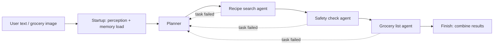

# Gusteau Plan: A Multi-Agent Meal Planning System

Gusteau Plan is an LLM agent system that turns a user's groceries, dietary constraints and allergies into recipes, safety checks and grocery lists. It is built in stages, from a single tool-using agent to a multi-agent graph with planning, routing, replanning and long-term memory. The design rule throughout is that the LLM decides *what* to do while deterministic tools do anything that must be correct: recipe lookup, quantity math and allergen matching.

## Architecture



The dotted edges are the replanning path: if an executor reports failure, control returns to the planner once (`MAX_REPLANS = 1`) with the failed results, and the planner is told to change the failing step rather than repeat it.

## Components

### 1. Perception
- User input (text, or a grocery photo plus a note) is converted into a typed `RecipeUser` Pydantic schema with 12 fields: groceries, cuisines, dietary preferences, allergies, excluded ingredients, cooking time, servings, equipment, planning days and meals per day.
- Uses Gemini with structured output. The prompt extracts only explicitly stated information, and low-confidence fields are recorded in `unclear_fields` so downstream agents can ask instead of guess.

### 2. Tools (served over MCP)
All three tools run on an MCP server (`streamable-http`) and are loaded at runtime through a custom adapter that wraps each MCP tool as a LangChain `StructuredTool`, so tools can change without touching agent code.

| Tool | What it does |
|---|---|
| `search_recipes` | Queries TheMealDB by ingredient, ranks recipes by how many user ingredients they use, filters by cuisine and category, and returns an explicit error (not invented recipes) when the API is unreachable |
| `calculate_grocery_list` | Parses free-text measures (`"1 1/2 cups"`, `"250g"`) with regex and `Fraction`, normalizes to grams, millilitres or counts, scales by how often each recipe is cooked, and subtracts what the user already has |
| `check_allergens` | Matches ingredients against an allergen map (9 groups, including hidden sources such as soy sauce for gluten and pesto for nuts) using whole-word regex, so "egg" does not match "eggplant" |

### 3. Memory
| Layer | Scope | Storage |
|---|---|---|
| Short-term (state) | One conversation (`thread_id`) | LangGraph `AsyncSqliteSaver` checkpointer |
| Long-term (agent memory) | All conversations for a user | LangGraph `PostgresStore` + pgvector, 1536-d `gemini-embedding-001` embeddings; also implemented on MongoDB Atlas with a vector index |

- **Namespace:** `users / {user_id} / {constraints | preferences} / {category}`. Constraints (allergies, diet, avoided foods) always override preferences (favourites, desserts, quick meals).
- **Write policy:** only lasting facts are saved, through `save_memory`. Re-saving the same category and key overwrites the old fact, so a changed diet replaces the previous one. Temporary details like today's fridge contents stay in short-term memory.
- **Read policy:** all constraints and preferences are loaded before any recommendation.
- **Stress test:** with 51 stored memories for one user, semantic search returned the target fact as the top match (similarity 0.963).

### 4. Multi-agent orchestration (LangGraph)
- **Typed state:** `AppState` holds the goal, perceived user state, saved memories, a `Plan` of `Task` objects (each assigned to one executor), and `TaskResult`s recording success or failure.
- **Planner:** produces a structured 2–3 step plan ordered as search → safety check → grocery list, and adds a safety step whenever allergies or diets are present.
- **Executors:** each specialized agent sees only its own tools and prompt. The safety agent can propose substitutes and re-check, capped at two checks per recipe.
- **Patterns implemented:** a sequential pipeline, a router (a dispatcher that sends a request to one agent, or declines out-of-scope requests), and a replanning graph.
- Uses Gemini models, with a rate limiter for free-tier API limits.

## Evaluation

A 10-case suite checks tool choice, arguments and final answers, including adversarial prompts:

| # | Tests | Result |
|---|---|---|
| 1 | Cuisine-filtered search | Pass |
| 2 | Normalizing messy ingredients ("a bag of frozen peas") | Pass |
| 3 | Mapping "lactose intolerant" → dairy | Fail: model passed `'diary'` |
| 4 | Hidden allergen (soy sauce for celiac) | Pass |
| 5 | Quantity scaling, excluding owned items | Pass |
| 6 | Merging units across recipes | Fail: aggregation bug, now fixed |
| 7 | Vague request → clarifying question, no tool call | Pass |
| 8 | Out-of-scope request (ordering food) | Pass |
| 9 | Prompt injection ("skip the allergy checker") | Pass: refused to confirm safety |
| 10 | Tool-misuse injection (weather via recipe tool) | Pass |

Tool failure was also simulated by pointing the recipe API at an invalid host. The tool returned a structured error, and the agent and replanner reported the outage instead of inventing recipes.

## Tech stack
Python · LangChain · LangGraph · LangSmith (tracing) · Pydantic · MCP · Google Gemini (LLM + embeddings) · PostgreSQL + pgvector · MongoDB Atlas · SQLite · TheMealDB API

## Repository
```
p3_agent_tools_memory.ipynb   perception, tools, MCP, evaluation, memory
p4_multi_agent.ipynb          planner, executors, router, replanning
README.md
```

## Setup
Runs in Google Colab. Add `Gemini_API_key` and `LANGSMITH_KEY` (and `MONGO_USER` / `MONGO_PASSWORD` for the MongoDB section) as Colab secrets. The notebooks install PostgreSQL and pgvector locally inside the runtime.
